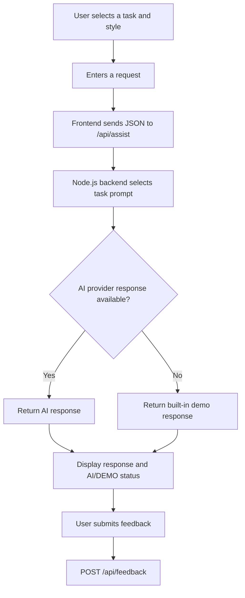
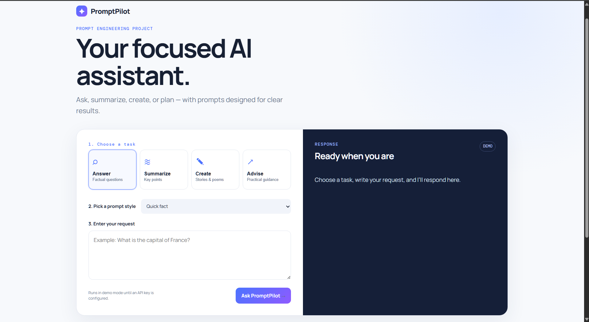
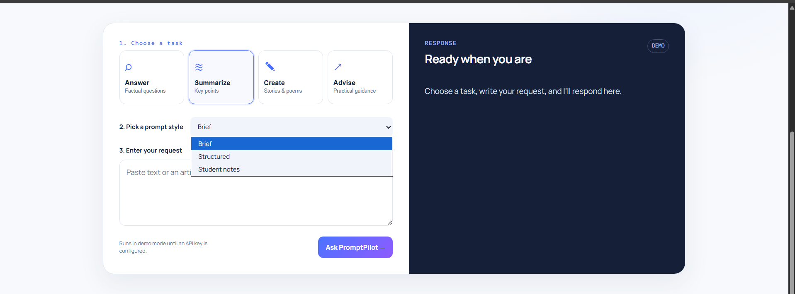
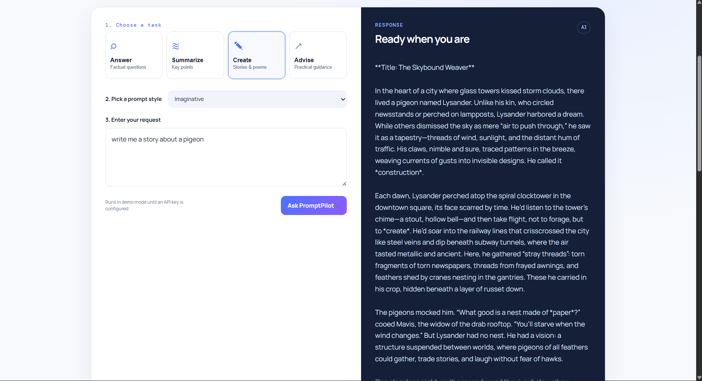
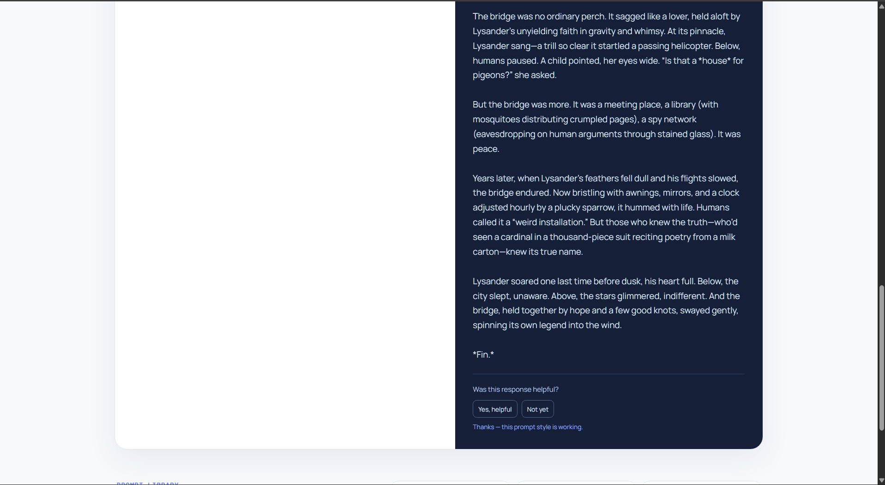

# PromptPilot – A Web-Based AI Assistant Using Prompt Engineering

PromptPilot is a lightweight web-based AI assistant that makes common AI tasks easier through guided task selection and prompt styles. Instead of starting with a blank chat box, users choose what they want to do, select a response style, and enter their request.

**Live application:** [https://promptpilot-six.vercel.app](https://promptpilot-six.vercel.app)  
**Source code:** [https://github.com/Shak33LX/promptpilot-ai-assistant](https://github.com/Shak33LX/promptpilot-ai-assistant)

---

## Features

- **Four assistant modes** for common tasks: Answer, Summarize, Create, and Advise.
- **Twelve prompt styles** with three choices under each mode.
- **AI provider integration** with OpenRouter and OpenAI.
- **Built-in demo responses** so the application can demonstrate its workflow without an API key.
- **AI/DEMO status indicator** to show the response path reported by the backend.
- **Feedback controls** that let users mark a response as helpful or not yet helpful.
- **Responsive single-page interface** built with HTML, CSS, and vanilla JavaScript.
- **Vercel deployment configuration** for hosting the Node.js application.

## Assistant modes and prompt styles

| Mode | Purpose | Available styles |
|---|---|---|
| **Answer** | Respond to factual and study questions. | Quick fact, Explain simply, Study answer |
| **Summarize** | Condense supplied text into its main points. | Brief, Structured, Student notes |
| **Create** | Generate original creative content. | Imaginative, Constrained, Polished |
| **Advise** | Provide practical guidance and suggestions. | Action plan, Supportive, Compare options |

## How it works

1. The user chooses one of the four assistant modes.
2. The user selects a prompt style and enters a request.
3. The browser sends the selected mode and request to the Node.js backend through `POST /api/assist`.
4. The backend selects the matching task-specific system prompt and contacts the configured AI provider.
5. The response is returned to the browser and displayed in the response panel. If a usable provider response is unavailable, the backend can return a built-in demo response.
6. The user can submit a helpful/not-yet-helpful rating through `POST /api/feedback`.



## Technology stack

| Technology | Role in the project |
|---|---|
| **HTML5** | Structures the web interface. |
| **CSS3** | Styles the workspace and responsive layout. |
| **Vanilla JavaScript** | Handles task selection, prompt-style selection, requests, and response display. |
| **Node.js** | Runs the backend using the built-in `http`, `fs`, and `path` modules. |
| **OpenRouter API** | Provides access to supported language models through its chat completions API. |
| **OpenAI API** | Provides model responses through the Responses API. |
| **Vercel** | Hosts the application using the configuration in `vercel.json`. |
| **Git and GitHub** | Track and host the project source code. |

The backend uses Node.js's built-in HTTP module; **Express.js is not used**. The project does not declare additional npm dependencies for local execution.

## Project structure

```text
promptpilot-ai-assistant/
├── public/
│   ├── index.html       # Main page and interface structure
│   ├── styles.css       # Layout, styling, and responsive rules
│   └── app.js           # Task selection and frontend API requests
├── server.js            # HTTP server, prompt logic, API routes, and provider calls
├── vercel.json          # Vercel deployment configuration
├── package.json         # Project metadata and run scripts
├── USER_GUIDE.md        # Instructions for using PromptPilot
├── Project_Submission.md  # Project documentation
└── .gitignore           # Excludes local configuration and generated files
```

## Run locally

### Requirements

- [Node.js](https://nodejs.org/) 18 or later
- Git (to clone the repository)
- A modern web browser

### 1. Clone the repository

```bash
git clone https://github.com/Shak33LX/promptpilot-ai-assistant.git
cd promptpilot-ai-assistant
```

### 2. Configure an AI provider (optional)

PromptPilot can run in demo mode without an API key. To receive model-generated responses, create a local `.env` file in the project root and add the credentials for the provider you want to use.

**OpenRouter:**

```env
OPENROUTER_API_KEY=your_openrouter_api_key
OPENROUTER_MODEL=openrouter/free
```

**OpenAI:**

```env
OPENAI_API_KEY=your_openai_api_key
OPENAI_MODEL=gpt-4.1-mini
```

You can also set `PORT` to change the local server port. The default is `3000`.

> Keep API keys private. Do not commit your `.env` file or paste secret keys into frontend code. The repository's `.gitignore` excludes `.env`.

### 3. Start the application

```bash
npm start
```

Then open [http://localhost:3000](http://localhost:3000) in your browser.

For the development script, you can also run:

```bash
npm run dev
```

No `npm install` step is required for the current local setup because the project does not declare third-party npm packages.

## AI provider behaviour

The backend checks OpenRouter first. If OpenRouter is not configured and returns no response, it can try OpenAI when an OpenAI key is available. If a provider request throws an error, or neither provider returns a usable response, the backend returns a built-in demo response.

Default model values in the current code are:

- **OpenRouter:** `openrouter/free`
- **OpenAI:** `gpt-4.1-mini`

The frontend displays an **AI** or **DEMO** badge based on the mode returned by the backend. Actual AI responses require valid credentials and provider availability; demo responses are predefined examples and are not generated by a language model.

### Prompt handling note

The backend contains one task-specific system prompt for each assistant mode. The selected style name is added to the user's request before it is sent to the provider. The longer style descriptions defined in the frontend are currently used for interface guidance and are not sent in full to the model.

## API routes

### `POST /api/assist`

Generates an answer for a selected assistant mode.

**Request body:**

```json
{
  "functionName": "question",
  "userInput": "Quick fact approach: What is photosynthesis?"
}
```

Accepted `functionName` values:

- `question`
- `summarize`
- `creative`
- `advice`

**Successful response:**

```json
{
  "answer": "Photosynthesis is the process...",
  "mode": "Free AI mode"
}
```

The `mode` value identifies the response path used by the backend, such as `Free AI mode`, `AI mode`, or `Demo mode`. Empty input or an unsupported mode returns a `400` response.

### `POST /api/feedback`

Receives a user's rating and the related request and response.

**Request body example:**

```json
{
  "rating": "yes",
  "functionName": "question",
  "request": "What is photosynthesis?",
  "response": "Photosynthesis is the process..."
}
```

The backend attempts to append the feedback entry, together with a timestamp, to `feedback.json` and returns a JSON status. The file is excluded from Git by `.gitignore`.

## Deployment on Vercel

The repository includes a `vercel.json` configuration that routes requests to `server.js` using the `@vercel/node` runtime.

To deploy:

1. Import this GitHub repository into [Vercel](https://vercel.com/).
2. Add the required provider environment variables in the Vercel project settings if you want live AI responses.
3. Deploy the project.
4. Open the deployment URL and test each assistant mode.

When deploying, configure secrets in Vercel's Environment Variables rather than placing them in source files.

## Current limitations

- PromptPilot does not train or host its own language model; it sends requests to external AI providers.
- The current application does not maintain multi-turn conversation history or persistent conversation memory.
- Feedback is written to a local `feedback.json` file. Reliable persistence on Vercel is not verified, so this approach should not be treated as durable production storage.
- The interface currently displays generated responses as plain text rather than rendering Markdown.
- The full descriptive text for each prompt style is not currently forwarded to the AI provider; the selected style name is added to the request instead.
- AI responses depend on valid provider credentials, provider availability, and any applicable usage limits.

## Future improvements

- Add a managed database for reliable feedback storage and analysis.
- Render sanitised Markdown responses in the interface.
- Support streaming responses for a more responsive experience.
- Add conversation history and multi-turn context.
- Allow users to select models and providers from the interface.
- Forward complete prompt-style instructions to the backend.
- Add automated tests for API routes, provider errors, and fallback behaviour.

## Screenshots

The repository includes screenshots of the main interface and its workflow:

| Home page | Task selection |
|---|---|
|  |  |

| Generated response | Feedback controls |
|---|---|
|  |  |

## Documentation

- [User Guide](USER_GUIDE.md)
- [Project Submission and Technical Documentation](Project_Submission.md)

## Author

**Mohamed Shakeel M B**  
AI & Prompt Engineering Intern – VaultofCodes

---

*PromptPilot is an educational project demonstrating a practical web application built with prompt engineering and external AI APIs.*
